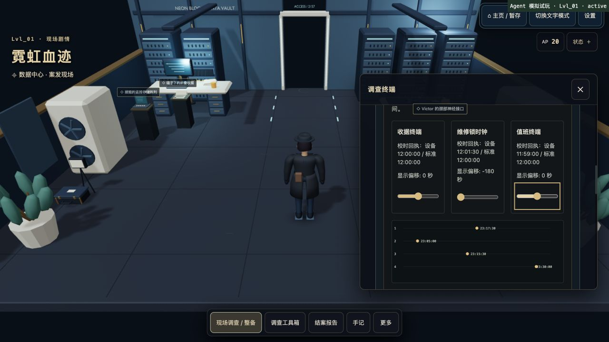

# Bug 与安全边界检查 · 2026-10-15

## 已修复的问题

| 问题 | 修复与验证 |
| --- | --- |
| 新版案件在客户端开案时被拒绝 | 页面已协商 `investigation_version: 2`，但客户端命令白名单不允许该字段，导致 `PROFILE_COMMAND_INVALID`，请求甚至未发到服务端。现允许合法的 1/2，并在本地日志中保留版本。新增真实页面处理器 → 命令序列化 → 重试日志 → Worker → 内存数据库集成测试，确认支持 v2 时创建 v2，旧服务端不支持时仍创建旧案。 |
| 完成审讯后免费复查仍修改人物状态 | 完成两阶段证词后，反复明确追问会免费降低合作度、增加审讯计数并挤掉历史问题。现已成为只读复查；八案三名 NPC、新旧 v2、多种语气均覆盖。未完成阶段的明确追问现在也返回真实的合作度变化，避免界面显示 0 而实际扣减。 |
| 小体积、深层 JSON 导致服务端 500 | 约 14KB、7,000 层数组虽然没有超过请求体限制，但会导致命令哈希递归栈溢出。现以非递归检查限制最大结构深度；run/profile 两接口在数据库访问前返回受控 400。合法团队配置和分组报告仍通过。 |
| 非字符串命令类型导致服务端 500 | `type` 为特制对象时，属性转换可能抛 TypeError。现先严格检查字符串类型，再按命令白名单处理。异常类型回归通过。 |
| 同帧重复点击核验造成错误反馈 | React 尚未重渲染时，旧 `locked` 值无法阻挡第二次调用。上层会拒绝重复命令，但它可能清除加载状态、覆盖成功提示。现增加同步操作锁、选项读取去重和视图归属检查；旧目标、旧运行、失活后的异步结果不能覆盖当前提示或释放新请求的加载状态。 |
| 查看资料导致未提交重建操作丢失 | 调查面板卸载会清空路线/事件选择、校时与波形对齐。现由 Terminal 持有纯内存草稿，按账号、运行、谜题和访问 token 隔离；查看手记、工具、切换文字/3D后可恢复。旧回调不能污染新上下文。浏览器刷新仍清空未提交草稿；已完成核验继续从服务端恢复。 |

修复保留原 AP、费用、服务端裁定、奖励与角色动画；没有改写旧存档，也没有修改数据库表结构。

## 依赖公告处理

查询官方 npm 审计端点并核对项目实际依赖图，已更新：

- Wrangler `4.128.0 → 4.151.0`，同主版本更新同时修复其开发工具链中的相关公告。
- Firestore 的间接 gRPC 依赖 `1.9.16 → 1.13.6`，通过限定在 Firestore 下的 override 锁定。该版本属于上游公布的修复线；应用自身只导入 Firebase App/Auth，未使用 Firestore/gRPC。[gRPC 官方公告](https://github.com/grpc/grpc-node/security/advisories/GHSA-m9gg-hp2v-232j)
- `brace-expansion 1.1.18 → 1.1.21`、`source-map-js 1.2.1 → 1.2.2`，均为原依赖范围内的补丁。

审计记录由 17 项降至 **7 项**：5 high、2 moderate，全部来自 Tailwind 3 构建工具链；**生产依赖审计为 0 项**。这里的项数包含传递依赖的重复归因，不能视作同等数量的独立线上漏洞。

剩余包为 `braces`、`chokidar`、`fast-glob`、`micromatch`、`postcss-nested`、`postcss-selector-parser`、`tailwindcss`。当前页面没有上传并编译 CSS、用户指定 glob 或运行时 Tailwind 编译入口；构建配置仅扫描固定的仓库源码路径。实际浏览器打包图和最终 Worker 的 62 个源模块均未包含这些剩余包。本次未发现玩家输入可达这些问题触发位置的路径。

风险仍包括开发/CI 处理不可信源码、配置或 glob。Braces 官方注册表最新仍为 3.0.3，上游问题尚未给出修复发布；不为清除审计计数强行迁移 Tailwind 大版本。PostCSS 解析器已有 7.1.6 修复，但当前 Tailwind 3 使用 6.x 范围，升级需要单独验证兼容性。[Braces 上游讨论](https://github.com/micromatch/braces/issues/70)、[PostCSS 官方公告](https://github.com/postcss/postcss-selector-parser/security/advisories/GHSA-rj75-hqrm-r3gf)

可复查的审计摘要见 [依赖审计记录](dependency-audit-20261015.json)。

## 验证结果

| 检查 | 结果 |
| --- | --- |
| npm test | **1,033/1,033 通过**，0 失败/跳过 |
| npm run typecheck | 通过 |
| npm run lint | 通过 |
| npm run security:check | 通过，486 个源文件及 Git 历史；注册表来源合法 |
| npm run build | 通过，保留已有 3D 大分块提示 |
| Blender 资产验证 | 通过，9 个 GLB；本轮无模型改动 |
| 私有文本/导入边界扫描 | 698 条私有文本、20 个 JS、28,104 个解码字面量：零命中、零越界导入 |
| Wrangler 4.151.0 deploy --dry-run | 通过，仅本地打包，没有发布 |
| npm audit --omit=dev | 通过，0 公告命中 |
| npm audit（全量） | 仍返回 7 项构建链记录，未宣称清零 |
| git diff --check | 通过 |

鉴权、账号隔离、会话锁、revision/CAS、操作重试、一次性结算、私有材料与后续证词公开边界的专项测试通过，未发现可复现的跨账号读写、重复奖励或未取得答案泄漏。本轮审查不等于完整渗透测试或线上基础设施审计。

## 真实界面回归

使用仅监听 127.0.0.1 的独立服务、真实 React/Worker 和内存数据库，预置专属核验的四份前置证据。这是开发者知情回归，不是从零通关或盲测，没有连接生产数据库。

实际选择两条重建材料，将维修锁显示偏移调整为 -180 秒；打开手记后回到现场，选择和偏移保留。切换文字模式再回 3D，仍为两条选择和 -180 秒，AP 始终为 20。该偏移是用于检查状态保持的任意测试值，没有提交为正确答案。浏览器捕获到的 error/warn 为零。

同帧重复点击与过期异步结果采用可控时序的组件回归覆盖，未在浏览器中人为制造生产网络延迟。临时标签页和服务已关闭，用户原有 5177 服务未动。本轮未 push、未部署，也未执行生产登录验证。

