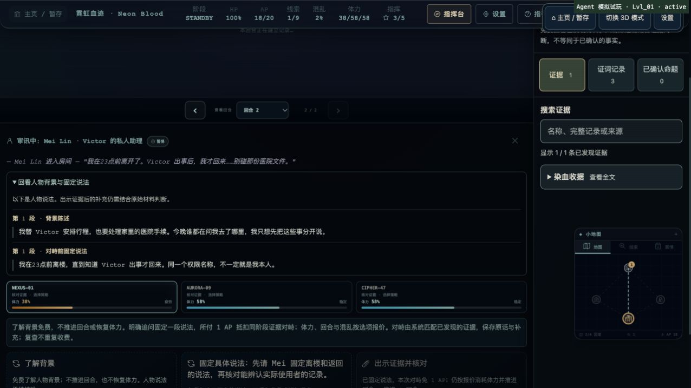
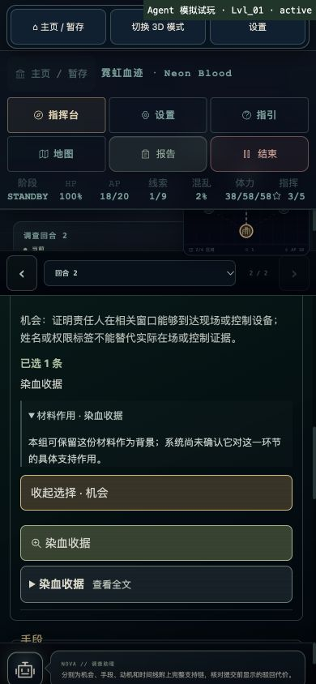

# 游戏缺陷检查与独立 agent 试玩 · 2026-10-15

本轮检查实际 Worker 的公开调查协议，并补充桌面、390px 窄屏、键盘及刷新恢复的实际界面验证。两名 agent 分别以中文谨慎型、英文探索型玩家完成四案。没有推送或发布，也没有改动用户原有的 `127.0.0.1:5177` 服务。

## 已确认的问题与修复

### 三组合理的支持关系被误判

试玩者按照已获得的材料，自然提交了以下连线，却遭到拒绝并增加混乱：

| 案件 | 关系 | 材料确实支持的事实 |
| --- | --- | --- |
| 霓虹血迹 | c_02 + c_05 | 定向接口烧痕与同会话脉冲回执印证脉冲致伤 |
| 霓虹血迹 | c_02 + c_07 | 接口伤痕与 EMP 监控中断印证脉冲影响 |
| 幽灵协议 | d_01 + d_05 | 引燃前已清空的芯片与案前保全指令印证诱饵计划 |

新增三条明确限定证明范围的中英命题，全部是普通支持关系，不计作排除替代解释。正反方向重复不会重复奖励；未获得的线索不能提交。冻结的旧内容版本保留原判定，报告的其他证据要求和 A/S 门槛不受这些关系影响。

错误连线反馈原先统一强调时钟，甚至在玩家选择“支持”时也如此。现在分别解释支持、矛盾、先后关系的判断要求；界面补充同一材料可能记载多个事件的提醒，不公布尚未确认的正确配对。

### 红蝶陷阱的机会证据组合遗漏

P03 首报附上 e_03 独立门侧影像和读卡原件、e_04 本人活体部署与独立控制器执行回执，仍被全部列为机会维度的背景。原支持表强制要求 e_03 + e_05 的目击路线，没有同步新版材料中已经增强的独立事实。

当前内容版本新增 e_03 + e_04 的机会替代路线。原目击路线继续有效；单份材料仍不构成完整覆盖，时间线和手段维度仍按各自要求判断。旧内容版本继续使用原规则。

### 审讯风险的无障碍说明遗漏

提问按钮的 `aria-label` 覆盖了子文本，屏幕阅读器只能读取问题和 AP/体力费用，无法完整读到推进回合、混乱增加和证词抵扣效果。现为效果说明生成唯一 ID，通过 `aria-describedby` 与按钮关联；旧版没有效果说明时不创建空引用。已检查中英两种显示及实际 DOM 引用，键盘 Enter 能执行所选问题。

### 私有语料扫描基线同步

三条新增双语命题使当前内容版本的命题语料从 150 条增至 156 条。扫描器原有严格计数正确地阻止了未审阅变更；审阅后仅更新当前版本的预期值，旧版仍要求精确 150 条，其他覆盖约束保持原值。六条新增文本的负向注入均被阻止。

## 两名 agent 的四案试玩

试玩通过真实的 `handleProfileFunction` / `handleRunFunction`，每局使用独立内存 SQLite、默认三探员、20 AP、每人 50 体力。agent 仅访问公开的案件、对象、线索、询问、核验和报告响应，没有读取源码、测试答案或其他玩家记录；没有修改资源、重置案件或枚举结论组合。

这属于合成玩家的公开协议试玩，不是真人盲测，也不是 agent 操作浏览器。CLI 自动审批及工具等待造成的耗时不能解释为玩家解题速度。

| 玩家 | 案件 / 语言 | 结案 | 剩余 AP | 回合 | 混乱 | 最终体力 NEXUS / AURORA / CIPHER | 报告提交 |
| --- | --- | --- | --- | --- | --- | --- | --- |
| P01 谨慎型 | 霓虹血迹 / 中 | B | 7 | 13 | 8 | 62 / 52 / 62 | 一次附件补正后通过 |
| P02 探索型 | 幽灵协议 / 英 | B | 6 | 14 | 11 | 56 / 46 / 76 | 首报通过 |
| P03 谨慎型 | 红蝶陷阱 / 中 | B | 8 | 12 | 2 | 58 / 58 / 58 | 一次附件补正后通过 |
| P04 探索型 | 白塔悖论 / 英 | B | 8 | 11 | 0 | 54 / 54 / 64 | 首报通过 |

试玩进程在修改规则前启动并固定加载模块。表中保留原始拒绝与资源结果，没有把修复后的自动回归冒充为重新进行的独立试玩。P03 的原始机会附件遗漏由单次补入已有目击证词恢复；新增替代路线通过后续回归验证。

实际覆盖包括免费背景、付费固定说法、同阶段 AP 抵扣、证据对峙、危机处理、场景往返、专属核验、合理连线、错误核验后的恢复，以及证据不足报告的补正。P02 故意先做了无法确定致伤事实的物品计数核验，支付 1 AP、增加 3 混乱后，按照反馈改用适当方法并继续通关。P01/P03 的首次附件补正没有结束案件或扣除额外资源。

初始 CLI 夹具遗漏了游戏地图本来具有的 `zone_connections`；P01/P02 曾遇到不相邻区域的旅行拒绝，资源没有变化。随后补全公开导航数据，没有重置进度。这是测试夹具的遗漏，不能计为产品地图缺陷。过期核验报价被拒后刷新选项也能继续，没有重复收费。

详细独立观察：

- [谨慎型试玩记录](agent-cautious-playtest-20261015.md)
- [探索型试玩记录](agent-explorer-playtest-20261015.md)

## 实际浏览器验证

另用隔离的 5213 测试服务操作真实应用界面，传输连接测试 Worker，不连接生产账号和数据库。测试完成后关闭自建标签并还原临时视口；用户的原标签和 5177 服务未改动。

- 完成入口页、模式选择、主页继续调查的实际路径，核验现场对象并取得 c_01；3D/文字模式切换后保留 19 AP、1 线索的同一进度。
- 免费往返区域及读取背景不消耗 AP/体力/回合；使用键盘 Enter 固定说法后为 18 AP、回合 2、混乱 2，执行者体力与公开报价一致。
- 没有必需证据时，证据对峙即使有 AP 抵扣也正确不可执行。已获得背景和原话可通过原生折叠控件复读，没有暴露未来阶段内容。
- 刷新并重新进入案件后，已获得线索、询问历史、AP、混乱和体力保留。
- 390 × 844 视口下，页面 `clientWidth` 与 `scrollWidth` 均为 390，没有横向溢出。实际操作了报告结论、机会附件和材料作用说明。
- 用 Return 展开材料说明；只填写一个结论并附 c_01 后刷新、重新进入报告，原结论及附件恢复，另外三维保持未填写。读说明没有自动添加附件或派发调查操作。
- 检查时浏览器日志没有 error/warn。对象 WebGL 预览显示了可继续调查的降级提示，不能据此声称通过真实 GPU 的 3D 视觉验收。

## 最终自动检查与交叉复核

| 检查 | 最终结果 |
| --- | --- |
| `npm test` | 1,190 通过；零失败、跳过或取消 |
| `npm run typecheck` | 通过 |
| `npm run lint` | 通过 |
| `npm run security:check` | 通过；522 个源文件及 Git 历史，依赖使用官方 npm 源 |
| `npm run build` | 通过；保留既有 3D 分块大于 500 kB 的构建提示 |
| `python3 scripts/blender/validate_assets.py` | 九个 GLB 全部通过，导航点可达，共 7,722,060 字节 |
| `node scripts/check-investigation-public-build.mjs` | 1,422 条去重私有语料、20 个生产 JS、28,414 个解码字面量；零命中、零导入越界 |
| `npx wrangler deploy --dry-run` | 通过，仅本地打包，没有发布或写入生产数据库 |
| `git diff --check` | 通过 |

新增 `investigationCorroboration.test.js` 九项和 `butterflyIndependentProof.test.js` 五项，覆盖两种语言、获得证据限制、反向重复、旧版/未知标记、序列化结算、材料用途说明，以及其他维度和更高评级门槛不被绕过。审讯组件回归检查效果描述的引用和旧版空引用；相关旧断言更新为精确描述新增的例外，没有删除冻结版本断言。

第三名 agent 在试玩结束后另行只读交叉复核修复，检查八案的关系键及命题 ID 唯一性、重复奖励、未获得材料投影、内容版本分派、A/S 条件和无障碍引用，没有发现可确认的新缺陷。这是源码与小型核对，不是第三名独立玩家。

完整生产包扫描记录见 [v2-public-build.json](v2-public-build.json)。前一轮因浏览器工具不可用而缺少的实际界面验证，已在本轮补做；历史记录见 [审讯与报告升级验证](interview-report-upgrade-20261015.md)。

## 验证边界与后续观察

没有真人参与、没有测量真实手机 GPU、没有测试线上登录供应商或生产数据库。本轮未重新烘焙角色，也没有改动步态、碰撞、停止即停或 R 疾跑。

幽灵协议 d_03 同时记载 02:26 启用和 02:41 回收，d_06 记载 02:34 屋顶经过。记录级连线仍容易让玩家把“启用早于经过”与系统的“经过早于回收”混淆；本轮保留既有的特定事件顺序及判定，增加准确的反馈和多事件提醒。后续可考虑事件级连线选择，避免一份材料中的多个事件共用一个端点。

试玩者也希望结案页直接说明 B 级与更高等级之间的额外条件；目前报告反馈重点仍是四维证据覆盖。这是可用性观察，不是本轮确认的扣费或评分错误。
