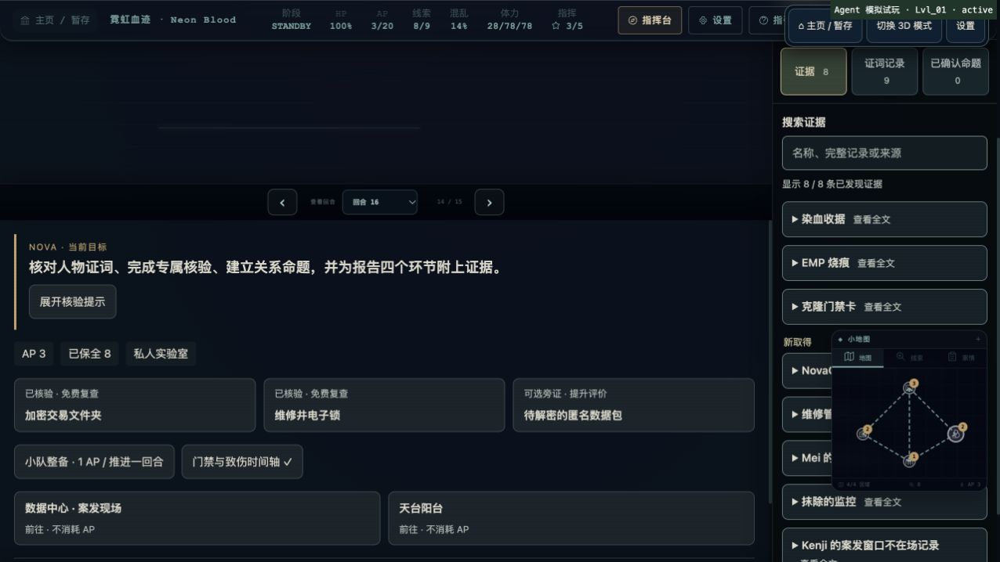
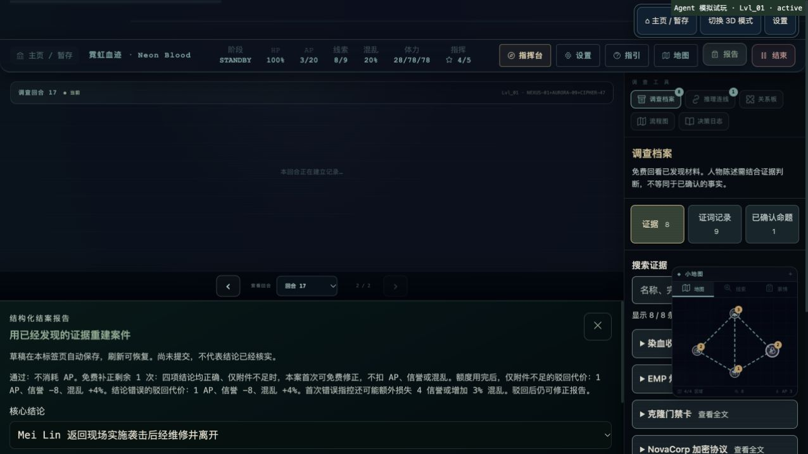
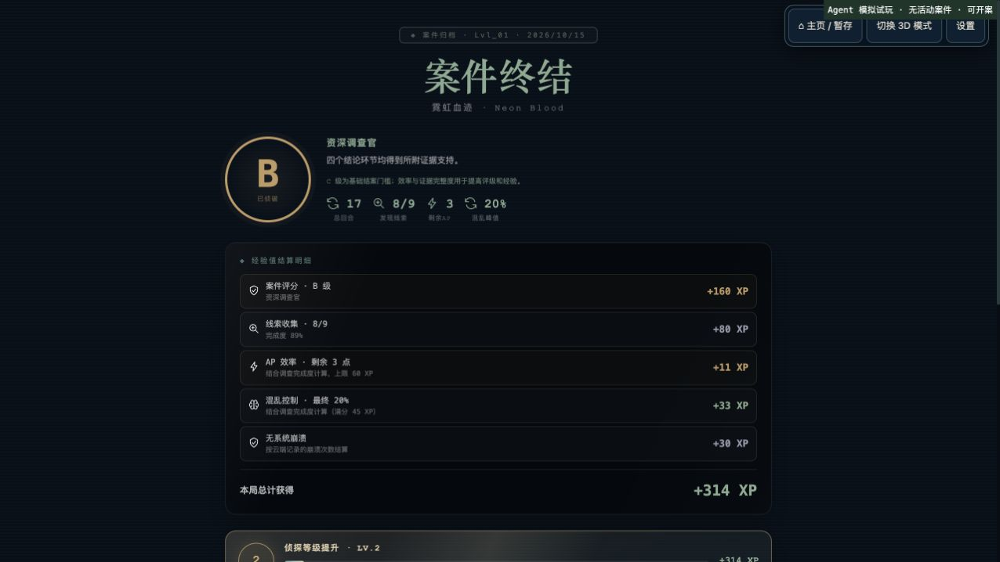

# 游戏交互与恢复问题验收 · 2026-10-15

本轮在调查档案与报告草稿优化的基础上，修复实际交互、回合归档和断线恢复问题。最终完整测试为 **954/954 通过**（本轮开始时为 937），无失败、跳过或取消。

## 修复的问题

| 问题 | 修复与回归覆盖 |
| --- | --- |
| 连线拖出面板仍可能按旧悬停目标提交；取消触摸后残留拖动 | 释放时重新命中本面板内已发现材料；pointer capture、取消、失去捕获、Escape 清理；排除其他手指与右键。 |
| 首开、滚动或调整尺寸后连线位置错位 | 挂载及 ResizeObserver 测量节点，坐标计入滚动偏移；过期材料 ID 不可提交。 |
| 零 AP 时，紧急节流后的免费专属核验仍被禁用 | 按服务端实际报价判断，仍校验执行者与忙碌状态；真实权威回归确认额度只抵扣一次。 |
| 核验选项失效或结果未确认后，界面继续保留旧报价 | 清空旧报价并提供显式重读入口；不自动重放收费动作；晚到结果不能覆盖新选择。 |
| 报告选项加载时关闭重开，可能撞单请求锁并卡在错误态 | 同案件、同语言复用在途请求；换语言按顺序读取，保留草稿。 |
| 连线已被服务器确认但回复丢失，恢复后页面仍显示失败 | 使用原操作收据恢复页面结果与选择；正确、错误关系及刷新恢复均不重复奖励或惩罚。 |
| 付费问答已推进回合，调查日志页码仍停留在前一回合 | 权威 turn_count 变化时统一同步页码与 refs；免费读取不抢走历史浏览、旧版回合预览。 |
| 对话框打开时只保存对话显示，问答回合没有终端记录 | 每次已确认的公开答复归档一次；连续问答保留各回合，断线恢复不重复追加。 |

另补充账号 A 切换到延迟加载的账号 B、同账号 token 刷新回归：原认证路由已有正确隔离，本轮没有为此修改生产认证代码。当前目标与方向提示相同的重复文本也已合并。

## 真实界面试玩

使用本机独立临时服务、内存 SQLite/D1 和真实 profile/run 处理器，通过浏览器操作真实 React 游戏界面。初始为默认队伍、20 AP、零证据；没有预填证据、修改能力或补充 AP。测试服务只监听 127.0.0.1，未连接生产数据库。

本次属于开发者知情回归试玩，不是盲测、真人新玩家测试，也不等同于八案全部界面通关。

实际完成首案：

- 2 次错误核验后仍能重新读取报价、选择正确方法并取得主线证据。
- 8 次成功基础核验，另完成 1 次免费复查：复查不重复扣 AP、不推进回合。
- 7 次区域移动均免费；中途从 3D 切换到文字模式，AP 与证据进度一致。
- 3 名 NPC 各完成 2 次关键证词进展，共 6 次；处理 2 次公开陈述危机。
- 完成专属时间排序核验，消耗 1 AP。
- 提交错误关系、重复同一错误关系，再建立有效关系；关系操作未消耗 AP。错误关系首次增加混乱，重复同错未再次增加。
- 填写四项报告及分组附件，刷新页面后继续调查：四项选择、四组附件均恢复，AP 与证据保持一致。
- 首次故意只为每组附一份证据：报告因附件不足被驳回，使用免费补正额度，AP、回合与混乱不变。
- 补齐证据后通过 **B 级结案**：17 回合、8/9 线索、剩余 3 AP、最终混乱 20%、314 XP。成功报告不消耗额外 AP；事件记录包含一次 settle_case。
- 浏览器捕获的 error/warn 为零。

资源核对：8 次基础核验 + 2 次错误核验 + 6 次问答 + 1 次专属核验 = 17 AP，剩余 3 AP。未收集可选隐藏旁证，未在本次 UI 路线取得 A/S 评价。

问答页码和归档问题是在本次路线中发现并热更新修复的；修复前错过的历史终端行不会自动补写。修复后的连续问答已确认上一回合可回看。刷新后已取得证据、证词和命题从权威状态恢复；终端逐行滚动日志本身仍是当前挂载期间的显示记录，不是完整持久历史。

脱敏命令事件见 [试玩记录](bugfix-gameplay-events-20261015.jsonl)，只包含操作类型、时间、revision、资源和通过状态，移除了 run/operation 标识，不包含令牌或答案正文。

## 自动验收

| 检查 | 结果 |
| --- | --- |
| npm test | 954 通过，0 失败，0 跳过 |
| npm run typecheck | 通过 |
| npm run lint | 通过 |
| npm run security:check | 通过，444 个源文件与 Git 历史 |
| npm run build | 通过；仍有既存 3D 大分块提示 |
| node scripts/check-investigation-public-build.mjs | 698 条私有文本、20 个浏览器 JS、27,362 个解码字面量，零命中、零服务端导入违规 |
| wrangler deploy --dry-run | 通过，仅本地打包，不发布 |
| git diff --check | 通过 |

完整套件包含八案权威通关、最低合法能力与 AP、旧运行版本、重复操作与一次性结算、报告恢复，以及现有移动/停止/R 疾跑/脚锁/动画资产回归。本轮没有重烘焙 GLB 或修改动画。

本轮未重测手机 GPU 帧耗时，未执行生产 Firebase 登录或生产发布。之前的移动布局截图及八案内容验收仍应与本次一案真实 UI 路线区分。

## 界面截图

