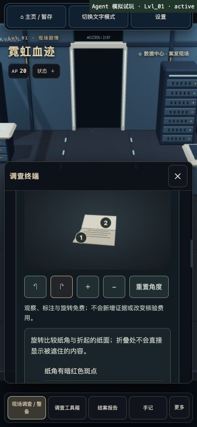
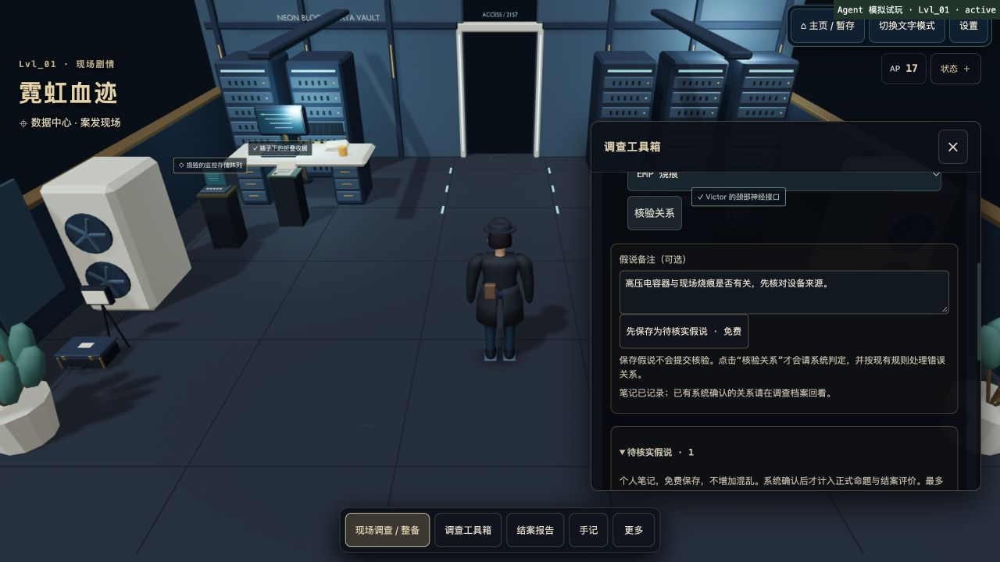
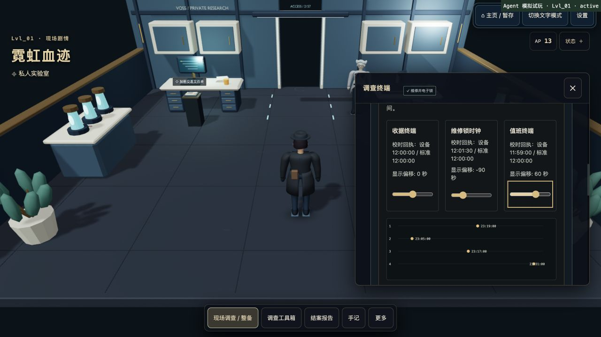
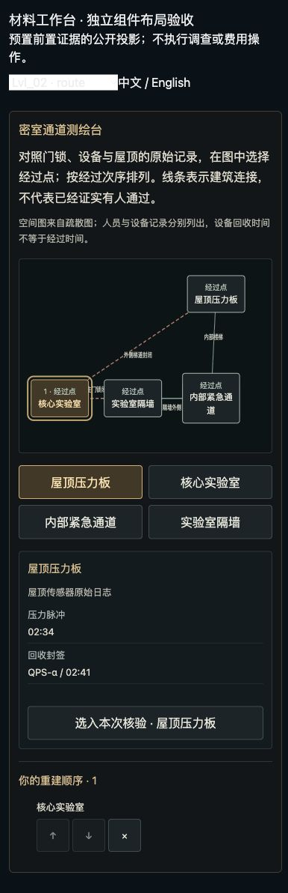
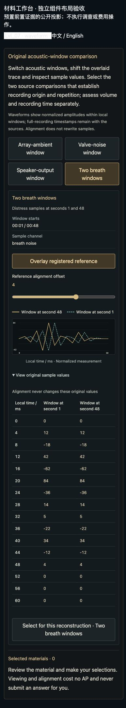

# 调查体验优化验收 · 2026-10-15

## 设计边界

遵循玩家的选择：保留系统承担一部分关键判断。证据对峙继续自动匹配可用材料，核验结果、证词推进、关系成立与报告结算仍由服务端裁定；本轮没有把游戏改为全部依赖手填答案的纯手工推理。原 AP、奖励、调查版本和角色步态规则保持兼容。

本轮未 push 或部署。工作区还包含此前的调查档案、报告草稿和交互恢复修复，详见 [上一轮验收](game-bugfix-20261015.md)。

## 已实现

| 改进 | 实际行为 |
| --- | --- |
| 八案原始材料工作台 | 首案校准独立时钟；第二、四案查看通道/维护路线；第三案并列查看恢复脚本与标准配置；第五案对齐监控与独立回执；第六案查看材料谱；第七案比对声学采样；第八案核对签章与执行记录。提供中英材料及键盘操作，观察、对齐与选取不消耗 AP，正式提交仍由服务端收费与判定。 |
| 已完成核验复查 | 完成后保留查看、对齐和测量操作，答案控件只读；新案的已确认重建顺序由权威状态恢复。未完成前不下发正确顺序。 |
| 物件观察 | 八案各有一个代表物件的几何细节，现场和近景复用；可旋转、缩放、重置、切换标注，并提供文字/WebGL 降级。展示公开观察及已取得的专业笔记。 |
| 探员观察辅助 | 根据所选探员的公开能力提供观察侧重点；不改变原费用、成功率或服务端结果。 |
| 免费假说笔记 | 可保存支持、矛盾、先后关系及备注，载入后再正式核验。保存、载入、删除不发送收费命令，也不增加混乱。 |
| 渐进引导 | 根据真实移动、观察、证据、证词、命题和报告阶段推进。提示不暂停场景；打开本地调查、对话或报告面板时隐藏，保留完整手动指南。 |
| HUD 与反馈 | 平稳时突出 AP，资源详情按需展开；危机及异常仍可见。字幕定时收起，手记保留全文。 |
| 结案回顾 | 按本局已经取得的证据、证词和已确认关系重建过程；只将明确先后关系表示为时间顺序，不补写未发现信息。连续晋升合并成可展开摘要。 |

假说笔记使用 sessionStorage，按账号、运行和案件隔离；支持存储失败后的内存降级。它仅保留当前标签页的笔记，不承诺跨设备同步。切换账号/运行后的旧回调不能覆盖新笔记。

## 新旧运行兼容与公开数据

- 只有带 `raw_materials_revision = 1` 的新运行启用新材料；既有 v2 和 v1 运行继续沿用原规则与材料，不改写正在进行的案件。
- 前置证据满足后才投影工作台。只有新版核验成功后，公开状态才包含已确认顺序；失败、尚未完成和旧运行都不下发该字段。
- 保留原谜底 ID、正式提交协议与费用，只有首案新运行增加两条有事实支持的等价报告证据路线。
- 私有材料保留在服务端，浏览器只获得当前允许观察的投影。生产包扫描 698 条私有文本、20 个 JS 文件、28,097 个解码字面量，零命中、零越界导入。扫描范围及限制见 [扫描结果](v2-public-build.json)。

## 实际界面回归

使用独立本机服务、内存数据库和真实 Worker 处理器，未连接生产数据库，未修改用户原有的 5177 开发服务。本次是开发者知情回归，不能作为新玩家盲测或真人试玩结论。

首案由真实 React 游戏界面操作并取得六份证据、完成专属校时核验：

- 实际移动达到阈值后推进移动教程；单纯打开页面不会视为已移动。
- 390×844 手机布局可查看、旋转观察物件。844×390 横屏检查发现引导和面板重叠，已修复为打开面板时隐藏引导。
- 错误核验后能重新读取选项并重试，正确方法正常取得证据。
- 保存假说前后均为 AP 17、混乱 3%，没有收费或惩罚。
- 用键盘完成独立时钟偏移调整；观察、对齐、选材不收费，正式提交消耗一次 1 AP，完成后禁止重复提交。
- 完成后刷新恢复已确认顺序由权威序列化/恢复测试覆盖；旧运行与未完成状态不返回答案。

另用带有前置证据的公开投影，挂载真实工作台组件进行独立布局验收；该夹具不执行案件命令，也不代表八案完整界面通关。390×844 下检查路线、脚本和声学材料，中英切换、键盘选择节点、切换标准配置、调整波形对齐和展开采样表均正常。发现路线图的 `aspect-ratio` 与最小高度共同撑宽容器，已显式限制宽度；修复后三类工作台均无页面横向溢出。

截图：

## 自动检查

| 检查 | 结果 |
| --- | --- |
| npm test | 1,013 通过，0 失败、跳过或取消 |
| 材料权威与工作台最终专项 | 36/36 通过，含已完成顺序恢复、未完成防泄露、键盘和只读复查 |
| 集成只读审查 | 未发现可复现的严重问题；账号生命周期、笔记、引导、回顾和 HUD 的 29 项专项通过 |
| npm run typecheck | 通过 |
| npm run lint | 通过 |
| npm run security:check | 通过，473 个源文件 |
| npm run build | 通过；仍有既存 3D 大分块提示 |
| python3 scripts/blender/validate_assets.py | 通过，9 个 GLB，7,722,060 字节；本轮无 GLB 改动 |
| 私有文本与导入边界扫描 | 通过 |
| wrangler deploy --dry-run | 最终源码打包通过，没有发布 |
| git diff --check | 通过 |

完整套件同时覆盖八案权威通关、最低合法能力/AP、旧运行、操作重试与结算，以及原有停止即停、疾跑、碰撞、脚锁和动画资产行为。

额外执行 `npm run build:cloudflare` 时，本机发布前置检查因缺少四项 `VITE_FIREBASE_*` 配置而停止。没有填入假配置；普通生产构建与 Worker dry-run 通过不等同于生产登录、完整发布流程或线上验证。本轮未测试真实手机 GPU 帧耗时，也未进行外部真人盲测。
