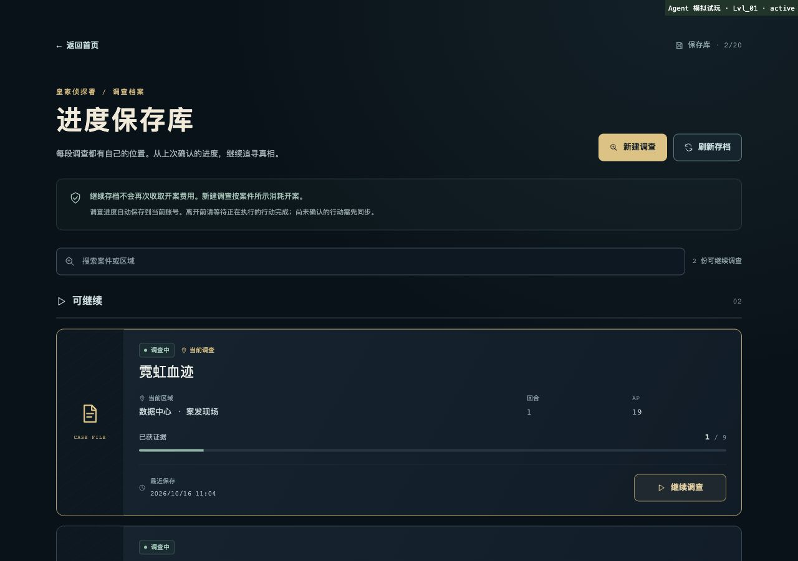
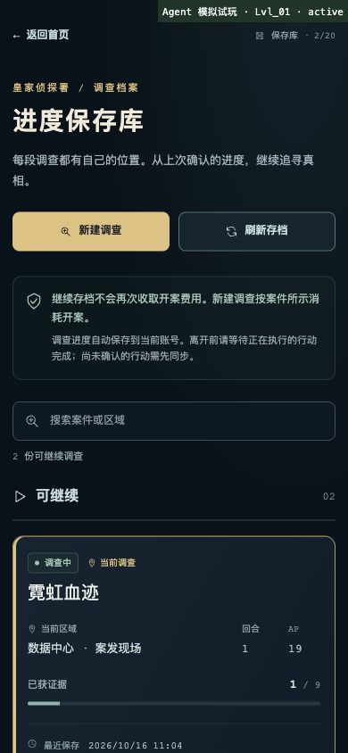

# 游戏进度保存库验收（2026-10-16）

首页提供“开始新调查”和“进度保存库”。新调查直接进入案件选择，使用已保存编队或默认合法队伍；战术编组可选。恢复已有调查不重复收取开案体力或消耗入场道具。

每个账号最多保存 20 份未结算调查，并显示最近 20 份只读结案历史。同一案件允许独立开档。证据、AP、区域、证词、推理、报告结果和开案编队随各自云端运行保存。未提交报告、推理笔记、重建选择、连线选择和 3D 镜头/位置保存在本机浏览器，按账号与存档隔离；不跨设备同步，也不恢复移动速度、按键或疾跑状态。

## 浏览器验收

使用独立端口 5216 的 Vite 页面、实际 Worker 处理器及内存 SQLite。身份与 ProfileContext 传输为模拟测试夹具；未访问生产账号、未修改生产 D1。原有 5177 服务未改动。测试后关闭独立服务和临时浏览器标签，恢复浏览器尺寸。

1. 从首页打开保存库，恢复原有“霓虹血迹”。
2. 核验折叠收据，取得 1 条证据，进入第 1 回合，剩余 19 AP。
3. 返回首页，选择“开始新调查”，直接新建“幽灵协议”；新档为 0 条证据、0 回合、20 AP。
4. 保存库显示两份独立记录，原档仍为 1 条证据、1 回合、19 AP。
5. 使用键盘 Enter 继续原档，恢复同一运行 ID、证据和 AP。
6. 刷新页面，再从首页进入保存库，两份记录和当前选择仍在；搜索“幽灵”仅显示对应案件。
7. 实际检查 390×844 和 1280×900 布局、列表滚动和按钮可达性。

结构化记录：[save-library-playtest-20261016.json](save-library-playtest-20261016.json)。

## 自动验证

- `npm test`：**1,257 / 1,257 通过**。
- 类型检查、Lint、安全检查、GLB 资产验证、生产构建、浏览器包私有答案扫描、Worker dry-run、`git diff --check` 通过。
- 覆盖独立同案存档、免费切换、容量、跨账号拒绝、并发切换/开案、旧运行版本、重复提交和每档一次结算。
- 覆盖待确认收据对账，确定被拒绝的 `RUN_NOT_SELECTED` 行动不会在恢复时自动执行；同档旧响应不能回退更新的运行 revision。
- 覆盖旧服务 capability 0 的单档兼容、异步账号切换、重挂载隔离、本机存储损坏与关闭重开、简报变化不覆盖最新空间快照。

## 上线前提

本次未 push、未部署、未执行远程迁移。配套 Worker 上线前需备份并检查生产迁移记录，审核应用尚未执行的 `0005_run_library.sql`。该迁移保留现有档案、调查和收据，补齐旧账号的当前存档指针并替换单档唯一索引；不能重跑清空数据的历史 `0002`。迁移与配套版本发布期间应按现有发布流程协调写入，避免旧 Worker 继续使用单档规则。
